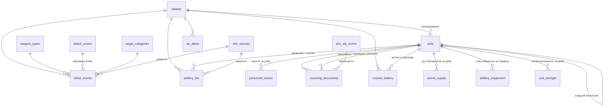

# Аналітичний дашборд оперативної обстановки

Навчальний проєкт.

- **Синтетичні (вигадані) дані:** події, втрати, документи і свої підрозділи. Свої підрозділи позначені «(умовна)».
- **Відкриті дані [DeepStateMap](https://deepstatemap.live):** лінія зіткнення, окупована і «сіра» зони, положення підрозділів противника. Їх подано з атрибуцією і датою «станом на»; це не офіційні дані.

PostgreSQL 16 → Python (FastAPI) → вебдашборд (Leaflet + OpenStreetMap / Natural Earth, milsymbol, Chart.js).
- Оформлення — за брендбуком ЗСУ.
- Умовні знаки, час і таблиці — за наказом № 140 (ВКДП 5(3)-00(01).02).
- Повне ТЗ: [TZ.md](TZ.md). Стан робіт: [PROGRESS.md](PROGRESS.md).
- **Покрокова інструкція (архітектура, запуск, структура файлів): [ІНСТРУКЦІЯ.md](ІНСТРУКЦІЯ.md).**

Модулі:
- **A** — повітряні удари (БпЛА, крилаті й балістичні ракети, КАБ) і тривоги;
- **B** — артилерія: обстріли, контрбатарейна боротьба, боєприпаси, стан артилерійського озброєння;
- **C** — особовий склад: втрати (лише агрегати) і укомплектованість;
- **D** — документообіг ОКП.

## Два способи відкрити дашборд

| Спосіб | Що потрібно | Звідки дані | Внесені записи |
|---|---|---|---|
| **1. Із сервером** (повний) | Docker Desktop | PostgreSQL через FastAPI | одразу в базі даних |
| **2. Без сервера** (будь-який комп'ютер) | лише браузер | знімок бази `frontend/data/dataset.js` | у браузері; вивантаження `.sql` / `.json` |

Режим дашборд визначає сам і показує плашкою в шапці: «Сервер: PostgreSQL» або «Офлайн: знімок бази».

### 1. Із сервером (Docker)

1. Встановіть [Docker Desktop](https://www.docker.com/products/docker-desktop/) (`winget install -e --id Docker.DockerDesktop`) і запустіть його. Потрібен WSL 2: `wsl --install --no-distribution` від адміністратора і перезавантаження (докладно — ІНСТРУКЦІЯ.md, 5.2).
2. Скопіюйте папку `Analytics-Dashboard` (або виконайте `git clone`) і відкрийте в ній термінал.
3. Виконайте `docker compose up -d`. Перший старт триває 1–3 хв: PostgreSQL завантажує `db/init/*.sql`.
4. Відкрийте http://localhost:8000. Документація API: http://localhost:8000/docs.

| Дія | Команда |
|---|---|
| Зупинити | `docker compose down` |
| Повністю скинути БД і завантажити дані заново | `docker compose down -v`, потім `docker compose up -d` |
| Логи | `docker compose logs -f api` |
| Підключитися до БД (DBeaver, pgAdmin) | `localhost:5433`, БД `dashboard`, користувач `dashboard_admin`, пароль з `.env` (за замовчуванням `change_me_local`) |

Порти й паролі задаються у файлі `.env` (зразок — [.env.example](.env.example)).

### 2. Без сервера

Скопіюйте папку `frontend/` на будь-який комп'ютер і відкрийте `frontend/index.html` у браузері (Edge, Chrome, Firefox).

- Працюють усі вкладки: KPI, графіки, карта, журнал з експортом CSV, друкована довідка, внесення даних.
- Інтернет потрібен лише для підкладки OpenStreetMap. Без нього карта сама перемикається на векторну схему Natural Earth (кордони, річки, міста); перемикач «Підкладка» — на панелі карти.

Як оновити знімок після змін у базі (наприклад, після внесення записів):
- `python -m backend.export_snapshot`;
- або завантажте http://localhost:8000/api/snapshot.js і покладіть у `frontend/data/dataset.js`.

## Де вносити дані

Вкладка **«Внесення даних»**.

| Що | Як |
|---|---|
| Один запис | Форма: повітряний удар, тривога, артилерія, контрбатарейна боротьба, боєприпаси, озброєння, втрати, укомплектованість, документ ОКП, підрозділ. Координати можна вибрати кліком на карті; область визначається автоматично |
| Багато записів | Імпорт **CSV** або **Excel (.xlsx)**. Кнопки «Шаблон CSV» / «Шаблон Excel» дають файл з потрібними колонками і аркушем-довідкою |

Як працює імпорт:
- спочатку показується попередній перегляд з помилками по рядках;
- далі діє правило «все або нічого»: якщо хоч один рядок з помилкою, не вноситься жоден;
- внесені записи одразу видно в KPI, графіках, на карті й у журналі (колонка «Походження запису»: «внесено вручну» / «імпорт»);
- синтетичні дані не змінюються і не видаляються; внесені записи можна видалити там само.

Без сервера записи зберігаються в браузері. Перенести їх у PostgreSQL можна так:
- **«Вивантажити .sql»** → `psql -d dashboard -f entries.sql`;
- **«Вивантажити .json»** → імпорт на цій самій вкладці, коли дашборд працює із сервером.

API для внесення: `POST /api/entry/{kind}`, `POST /api/import/{kind}` (CSV або JSON), `DELETE /api/entry/{kind}/{id}`. Значення `kind`: `strike`, `alert`, `artillery`, `counter_battery`, `ammo`, `equipment`, `losses`, `strength`, `document`, `unit`.

## PostgreSQL і SQL-файли (що здається)

| Файл | Зміст |
|---|---|
| [db/init/01_schema.sql](db/init/01_schema.sql) | схема: довідники, таблиці модулів A–D, обмеження, індекси |
| [db/init/02_views.sql](db/init/02_views.sql) | аналітичні представлення `v_*`, ролі `dashboard_ro` (читання) і `dashboard_rw` (внесення) |
| [db/init/03_seed.sql](db/init/03_seed.sql) | дані: 109 умовних підрозділів (87 фронтових і 22 тилові частини — навчальні центри, частини забезпечення — у тилових областях); 6 387 ударів (з них 1 035 балістичних); 18 108 тривог; 31 063 обстріли; 5 704 виявлені вогневі позиції (контрбатарейна боротьба); 9 855 добових записів руху боєприпасів; 1 404 щотижневі донесення про озброєння; 14 257 рядків втрат; 39 785 добових донесень про укомплектованість; 47 929 документів; 268 підрозділів противника і лінія зіткнення з DeepState |
| [db/dashboard_dump.sql](db/dashboard_dump.sql) | повний дамп (схема + дані + ролі) одним файлом |

## Запуск без Docker

Потрібні PostgreSQL 16 і Python 3.12+.

```
createdb -p 5433 dashboard
psql -p 5433 -d dashboard -f db/dashboard_dump.sql      # або по черзі db/init/01, 02, 03
python -m venv .venv
.venv\Scripts\activate            # Linux/macOS: source .venv/bin/activate
pip install -r backend/requirements.txt
copy .env.example .env            # Linux/macOS: cp
uvicorn backend.app.main:app --port 8000
```

## Для розробника

| Дія | Команда |
|---|---|
| Тести API (потрібна жива БД з `.env`) | `pytest backend/tests -q` |
| Зібрати фронтенд після зміни `frontend/js/*.js`, шрифтів або геоданих | `python tools/build.py` |
| Знімок бази для офлайн-режиму | `python -m backend.export_snapshot` |
| Оновити лінію, зони й противника з DeepStateMap | `python db/sources/update_deepstate.py` |
| Оновити підкладку без інтернету (Natural Earth) | `python db/sources/update_basemap.py`, потім `python tools/build.py` |
| Перегенерувати дані | `python db/generate_seed.py --seed 140 --from 2025-11-01 --to 2026-10-31` |

Про збірку: вихідний код — ES-модулі в `frontend/js/`. Сторінка підключає зібраний `js/bundle.js`, бо браузер не завантажує модулі зі сторінки, відкритої як файл. Крім бандла, `tools/build.py` створює `data/geo.js`, `data/basemap.js` і вбудовує шрифти в `css/fonts.css`.

Після перегенерації даних:
- `docker compose down -v && docker compose up -d`;
- `python -m backend.export_snapshot`.

Нормативи ОКП (умовні) задаються списком `NORMS` у генераторі.

## Карта

- **Вибір знака:** спершу наказ № 140; якщо там немає — APP-6 / MIL-STD-2525C; власні позначення — за п. 2.2.16, з поясненням у легенді. Знаки малює milsymbol, кольори — за табл. 6 Порядку. Окремим SVG-шаром ([symbols.js](frontend/js/symbols.js)) накладаються:
  - позначки ураження (п. 2.2.12);
  - «?» для неперевірених даних (п. 2.2.15);
  - смуга боєздатності AL.
- **Вогонь своєї артилерії:** ціль позначено знаком «Вогонь по одиночній цілі» з номером цілі (п. 6.2.2), синім (п. 2.2.2); результат — перехресні лінії (п. 2.2.12).
- **Контрбатарейна боротьба** (шар вимкнено за замовчуванням): виявлена вогнева позиція противника, підпис — джерело за п. 2.2.15 (РЛР, ПвР, АР, С).
- **Удари БпЛА, ракет і КАБ:** лише місця уражень — знак «Вибух, підрив» (п. 6.12) з підписом засобу БпЛА / КрР / БалР / КАБ. Траєкторій немає; подробиці — у графіках і журналі модуля A. Артилерійські засоби показано знаками ОВТ (класи калібру — за табл. 16).
- **Лінія зіткнення** (п. 6.2.1): синя лінія з дугами — свої, червона — противник. У монохромному режимі: одинарна / подвійна лінія і підпис «ПТН» (п. 2.2.13).
- **Масштаб.** Знаки збільшуються при наближенні, а дрібніші ланки з'являються поступово:

  | Масштаб | Свої | Противник | Потоки ОКП |
  |---|---|---|---|
  | 5,5 | ОСУВ, ОТУ | армії, корпуси | ОТУ → ОСУВ |
  | 6,5 | + бригади | + дивізії | + бригада → ОТУ |
  | 7 | + полки | | |
  | 8 | + батальйони | + бригади, полки | + батальйон → бригада |
  | 8,5 | + підписи | | |
  | 9 | | + батальйони | |
  | 9,5 | + роти | | + рота → батальйон |

  На масштабі 5 знаки зникають.
- **Потоки документів ОКП** йдуть по ланці управління «підлеглий → старший» замість десятків ліній до одного ОКП:
  - товщина лінії — обсяг документів;
  - колір — частка прострочених: < 5 % / 5–10 % / > 10 %.
- **Посилання на вид:** `/?z=9&c=48.75,37.4&layers=units,docs,line#map` (`layers` — набір увімкнених шарів).

## Структура

```
db/        init/01_schema.sql 02_views.sql 03_seed.sql · dashboard_dump.sql · generate_seed.py
           sources/ (межі областей, deepstate.json, basemap.json, update_*.py)
backend/   app/ (FastAPI: роутери модулів, entry — внесення, snapshot — знімок) · tests/ · export_snapshot.py · Dockerfile
tools/     build.py — збірка фронтенду
frontend/  index.html · print.html · css/ · js/ (модулі + bundle.js) · fonts/ · vendor/ · data/ (dataset.js, geo.js, basemap.js)
```

## ER-діаграма



Таблиці без зв'язків:
- `enemy_units`, `contact_line` — DeepState;
- `dataset_meta` — версія генератора, період.

Поле `origin` у таблицях фактів показує походження запису: `synthetic`, `manual` або `import`.

## Джерела та ліцензії

- Підкладка карти: © OpenStreetMap contributors (ODbL); без інтернету — Natural Earth (суспільне надбання).
- Межі областей: [geoBoundaries](https://www.geoboundaries.org/) (CC BY 4.0), спрощено.
- Лінія зіткнення, зони, противник: [DeepStateMap](https://deepstatemap.live), відкриті дані; не є офіційними даними.
- Бібліотеки:
  - Leaflet 1.9.4 і Leaflet.markercluster 1.5.3 (BSD-2);
  - milsymbol 2.x (MIT);
  - Chart.js 4.4.4 (MIT);
  - SheetJS CE 0.20.3 (Apache-2.0).
- Шрифт Volja (= UAF Sans): фірмовий шрифт ЗСУ, надано замовником.
- Офіційні логотипи ЗСУ не використовуються.
