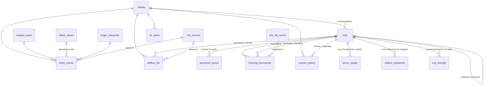

# Аналітичний дашборд оперативної обстановки

Навчальний проєкт.

- **Синтетичні (вигадані) дані:** події, втрати, документи і свої підрозділи. Свої підрозділи позначені «(умовна)».
- **Відкриті дані [DeepStateMap](https://deepstatemap.live):** лінія зіткнення, окупована і «сіра» зони, положення підрозділів противника. Їх подано з атрибуцією і датою «станом на»; це не офіційні дані.

PostgreSQL 16 → Python (FastAPI) → вебдашборд (Leaflet + OpenStreetMap / Natural Earth, milsymbol, Chart.js).
- Оформлення — за брендбуком ЗСУ.
- Умовні знаки, час і таблиці — за наказом № 140 (ВКДП 5(3)-00(01).02).
- Повне ТЗ: [TZ.md](TZ.md). Стан робіт: [PROGRESS.md](PROGRESS.md).
- **Покрокова інструкція (архітектура, запуск, структура файлів): [ІНСТРУКЦІЯ.md](ІНСТРУКЦІЯ.md).**
- **Запуск у терміналі VS Code** (папка `D:\github\Praktika2026\Analytics-Dashboard`): `cd D:\github\Praktika2026\Analytics-Dashboard` → `python -m venv .venv` → `.\.venv\Scripts\Activate.ps1` → `python -m pip install -r backend\requirements.txt` → `copy .env.example .env` → `docker compose up -d db` → `uvicorn backend.app.main:app --reload` → http://localhost:8000 (докладно — розділ «Запуск»).

Модулі:
- **A** — повітряні удари (БпЛА, крилаті й балістичні ракети, КАБ) і тривоги;
- **B** — артилерія: обстріли, контрбатарейна боротьба, боєприпаси, стан артилерійського озброєння;
- **C** — особовий склад: втрати (лише агрегати) і укомплектованість;
- **D** — документообіг ОКП.

## Структура проєкту

Проєкт поділено на дві частини: **бекенд** (Python, FastAPI, база даних) і **фронтенд** (те, що бачить браузер). Сайт запускає FastAPI командою `uvicorn backend.app.main:app`: один процес роздає і сторінки, і API.

```
Analytics-Dashboard/
├── docker-compose.yml      ← PostgreSQL + сервер у Docker
├── .env.example            ← зразок налаштувань (порти, паролі, ENTRY_TOKEN)
│
├── backend/                ← СЕРВЕРНА ЧАСТИНА
│   ├── app/                   FastAPI-застосунок
│   │   ├── main.py               точка входу (uvicorn backend.app.main:app): API + роздача фронтенду
│   │   ├── config.py · db.py     налаштування з .env, пули з'єднань (ролі dashboard_ro / dashboard_rw)
│   │   ├── filters.py · schemas.py · labels.py · sidc.py · geo.py · snapshot.py
│   │   └── routers/              модулі API: meta, kpi, air (A), artillery (B), losses (C), docs (D),
│   │                             map, journal, entry (внесення даних)
│   ├── database/              база даних PostgreSQL 16
│   │   ├── init/                 01_schema.sql · 02_views.sql · 03_seed.sql (виконуються по черзі)
│   │   ├── dashboard_dump.sql    повний дамп одним файлом
│   │   ├── generate_seed.py      генератор синтетичних даних (+ oblasts_ref.py)
│   │   └── sources/              межі областей, DeepStateMap, підкладка Natural Earth, скрипти оновлення
│   ├── scripts/               службові скрипти
│   │   ├── build_frontend.py     збірка фронтенду (src/ → js/bundle.js, геодані, шрифти)
│   │   └── export_snapshot.py    знімок бази → frontend/data/dataset.js (офлайн-режим)
│   ├── tests/                 тести API (pytest)
│   ├── requirements.txt
│   └── Dockerfile
│
└── frontend/               ← КЛІЄНТСЬКА ЧАСТИНА (роздається FastAPI; відкривається і як файл)
    ├── index.html · print.html   сторінка дашборду і друкована довідка
    ├── src/                      вихідний код (ES-модулі): app, api, offline, map, symbols, datefield,
    │                             entry, journal, kpi, charts/ (A, B, C, D) …
    ├── js/                       зібрані bundle.js і print.bundle.js (не редагувати вручну)
    ├── css/ · fonts/             стилі (брендбук ЗСУ), шрифт Volja
    ├── data/                     dataset.js (знімок бази), geo.js, basemap.js
    └── vendor/                   Leaflet, markercluster, milsymbol, Chart.js, SheetJS (локальні копії)
```

## Запуск

| Спосіб | Що потрібно | Звідки дані | Внесені записи |
|---|---|---|---|
| **1. FastAPI на цьому ПК** (основний: venv → бібліотеки → uvicorn у VS Code) | Python 3.12+, VS Code, PostgreSQL (у Docker або встановлений) | PostgreSQL через FastAPI | одразу в базі даних |
| **2. Усе в Docker** | Docker Desktop | PostgreSQL через FastAPI | одразу в базі даних |
| **3. Без сервера** | лише браузер | знімок бази `frontend/data/dataset.js` | у браузері; вивантаження `.sql` / `.json` |

Режим дашборд визначає сам і показує плашкою в шапці: «Сервер: PostgreSQL» або «Офлайн: знімок бази».

### 1. FastAPI на цьому ПК: запуск командами у VS Code (основний)

Папка проєкту: **`D:\github\Praktika2026\Analytics-Dashboard`**. Усі команди виконуються в терміналі VS Code (**Terminal → New Terminal**, PowerShell).

**Крок 0. Перейти в папку проєкту** — щоразу, коли відкриваєте новий термінал:
```powershell
cd D:\github\Praktika2026\Analytics-Dashboard
```
Якщо у VS Code відкрито весь репозиторій `D:\github\Praktika2026`, термінал стартує в його корені, тому без цього кроку команди не знайдуть файли проєкту. Можна відкрити одразу папку проєкту: **File → Open Folder → `D:\github\Praktika2026\Analytics-Dashboard`**. Перевірка: `pwd` показує `D:\github\Praktika2026\Analytics-Dashboard`.

**Крок 1. Віртуальне оточення (venv)** — один раз:
```powershell
python -m venv .venv
```
Створюється папка `D:\github\Praktika2026\Analytics-Dashboard\.venv` з окремою копією Python для проєкту. У git вона не потрапляє (`.gitignore` проєкту).

**Крок 2. Активувати venv** — щоразу, коли відкриваєте новий термінал:
```powershell
.\.venv\Scripts\Activate.ps1
```
На початку рядка терміналу з'явиться `(.venv)`.
Якщо PowerShell пише «running scripts is disabled», спершу виконайте `Set-ExecutionPolicy -Scope Process -ExecutionPolicy Bypass` і повторіть.
У VS Code також виберіть інтерпретатор: `Ctrl+Shift+P` → **Python: Select Interpreter** → **Enter interpreter path** → `D:\github\Praktika2026\Analytics-Dashboard\.venv\Scripts\python.exe`.

**Крок 3. Встановити бібліотеки** — один раз (в активованому venv):
```powershell
python -m pip install -r backend\requirements.txt
```
Встановлюються FastAPI, uvicorn, psycopg (драйвер PostgreSQL), pydantic, python-dotenv, pytest. Перевірка: `pip list`.

**Крок 4. Налаштування** — один раз:
```powershell
copy .env.example .env
```
У `D:\github\Praktika2026\Analytics-Dashboard\.env` — порт і паролі бази, `ENTRY_TOKEN`. У git цей файл не потрапляє.

**Крок 5. Запустити базу даних** (Docker Desktop має бути запущений):
```powershell
docker compose up -d db
```
PostgreSQL 16 на порту 5433. Перший старт 1–3 хв: завантажуються `backend\database\init\*.sql`. Перевірка: `docker compose ps` (статус `healthy`).
Без Docker — власний PostgreSQL 16: `createdb -p 5433 dashboard`, потім `psql -p 5433 -d dashboard -f backend\database\dashboard_dump.sql`.

**Крок 6. Запустити сайт:**
```powershell
uvicorn backend.app.main:app --reload
```
У терміналі з'явиться `База даних: PostgreSQL localhost:5433/dashboard — підключено` і `Uvicorn running on http://127.0.0.1:8000`.
Відкрийте **http://localhost:8000** (Ctrl + клік по адресі в терміналі). Документація API: **http://localhost:8000/docs**. Зупинити сервер — `Ctrl+C`.
`--reload` перезапускає сервер, коли змінюєте код бекенду. Інший порт: `--port 8080`.

**Наступного разу** — чотири команди:
```powershell
cd D:\github\Praktika2026\Analytics-Dashboard
.\.venv\Scripts\Activate.ps1
docker compose up -d db
uvicorn backend.app.main:app --reload
```

### 2. Усе в Docker

1. Встановіть [Docker Desktop](https://www.docker.com/products/docker-desktop/) (`winget install -e --id Docker.DockerDesktop`) і запустіть його. Потрібен WSL 2: `wsl --install --no-distribution` від адміністратора і перезавантаження (докладно — ІНСТРУКЦІЯ.md, 5.2).
2. У папці проєкту (`cd D:\github\Praktika2026\Analytics-Dashboard`): `docker compose up -d` → http://localhost:8000. Контейнер `api` запускає ту саму команду `uvicorn backend.app.main:app`.

| Дія | Команда |
|---|---|
| Зупинити | `docker compose down` |
| Повністю скинути БД і завантажити дані заново | `docker compose down -v`, потім `docker compose up -d` |
| Логи | `docker compose logs -f api` |
| Підключитися до БД (DBeaver, pgAdmin) | `localhost:5433`, БД `dashboard`, користувач `dashboard_admin`, пароль з `.env` (за замовчуванням `change_me_local`) |

Порти й паролі задаються у файлі `.env` (зразок — [.env.example](.env.example)).

### 3. Без сервера

Скопіюйте папку `frontend/` на будь-який комп'ютер і відкрийте `frontend/index.html` у браузері (Edge, Chrome, Firefox).

- Працюють усі вкладки: KPI, графіки, карта, журнал з експортом CSV, друкована довідка, внесення даних.
- Інтернет потрібен лише для підкладки OpenStreetMap. Без нього карта сама перемикається на векторну схему Natural Earth (кордони, річки, міста); перемикач «Підкладка» — на панелі карти.

Як оновити знімок після змін у базі (наприклад, після внесення записів):
- `python -m backend.scripts.export_snapshot`;
- або завантажте http://localhost:8000/api/snapshot.js і покладіть у `frontend/data/dataset.js`.

## Де вносити дані

Вкладка **«Внесення даних»**.

| Що | Як |
|---|---|
| Один запис | Форма: повітряний удар, тривога, артилерія, контрбатарейна боротьба, боєприпаси, озброєння, втрати, укомплектованість, документ ОКП, підрозділ. Координати можна вибрати кліком на карті; область визначається автоматично |
| Багато записів | Імпорт **CSV** або **Excel (.xlsx)**. Кнопки «Шаблон CSV» / «Шаблон Excel» дають файл з потрібними колонками і аркушем-довідкою |

Як працює імпорт:
- спочатку показується попередній перегляд з помилками по рядках;
- далі діє правило «все або нічого»: якщо хоч один рядок з помилкою, не вноситься жоден;
- внесені записи одразу видно в KPI, графіках, на карті й у журналі (колонка «Походження запису»: «внесено вручну» / «імпорт»);
- синтетичні дані не змінюються і не видаляються; внесені записи можна видалити там само.

Без сервера записи зберігаються в браузері. Перенести їх у PostgreSQL можна так:
- **«Вивантажити .sql»** → `psql -d dashboard -f entries.sql`;
- **«Вивантажити .json»** → імпорт на цій самій вкладці, коли дашборд працює із сервером.

API для внесення: `POST /api/entry/{kind}`, `POST /api/import/{kind}` (CSV або JSON), `DELETE /api/entry/{kind}/{id}`. Значення `kind`: `strike`, `alert`, `artillery`, `counter_battery`, `ammo`, `equipment`, `losses`, `strength`, `document`, `unit`.

**Код доступу.** Якщо у `.env` задано `ENTRY_TOKEN`, сервер приймає внесення і видалення лише із заголовком `X-Entry-Token`; дашборд сам запитає код при першому записі (код зберігається до закриття вкладки). Порожній `ENTRY_TOKEN` — без коду: так зручно на власному ПК, бо сервер і так доступний лише з `localhost`. Якщо запускаєте з `uvicorn ... --host 0.0.0.0` (доступ з мережі) — код обов'язковий. Читання даних код не потребує.

## PostgreSQL і SQL-файли (що здається)

| Файл | Зміст |
|---|---|
| [backend/database/init/01_schema.sql](backend/database/init/01_schema.sql) | схема: довідники, таблиці модулів A–D, обмеження, індекси |
| [backend/database/init/02_views.sql](backend/database/init/02_views.sql) | аналітичні представлення `v_*`, ролі `dashboard_ro` (читання) і `dashboard_rw` (внесення) |
| [backend/database/init/03_seed.sql](backend/database/init/03_seed.sql) | дані: 109 умовних підрозділів (87 фронтових і 22 тилові частини — навчальні центри, частини забезпечення — у тилових областях); 6 367 ударів (з них 1 042 балістичні); 18 164 тривоги; 31 443 обстріли; 5 795 виявлених вогневі позиції (контрбатарейна боротьба); 10 950 добових записів руху боєприпасів; 1 560 щотижневих донесення про озброєння; 14 220 рядків втрат; 39 785 добових донесень про укомплектованість; 48 240 документів; 268 підрозділів противника і лінія зіткнення з DeepState |
| [backend/database/dashboard_dump.sql](backend/database/dashboard_dump.sql) | повний дамп (схема + дані + ролі) одним файлом — для відновлення без Docker (`psql -f`) |

## Для розробника

| Дія | Команда |
|---|---|
| Тести API (активований venv, жива БД, `.env`) | `pytest backend/tests -q` |
| Зібрати фронтенд після зміни `frontend/src/*.js`, шрифтів або геоданих | `python -m backend.scripts.build_frontend` |
| Знімок бази для офлайн-режиму | `python -m backend.scripts.export_snapshot` |
| Оновити лінію, зони й противника з DeepStateMap | `python backend/database/sources/update_deepstate.py` |
| Оновити підкладку без інтернету (Natural Earth) | `python backend/database/sources/update_basemap.py`, потім `python -m backend.scripts.build_frontend` |
| Перегенерувати дані | `python backend/database/generate_seed.py --seed 140 --from 2025-11-01 --to 2026-10-31` |

Про збірку: вихідний код — ES-модулі в `frontend/src/`. Сторінка підключає зібраний `js/bundle.js`, бо браузер не завантажує модулі зі сторінки, відкритої як файл. Крім бандла, `backend/scripts/build_frontend.py` створює `data/geo.js`, `data/basemap.js` і вбудовує шрифти в `css/fonts.css`.

Після перегенерації даних:
- `docker compose down -v && docker compose up -d`;
- `python -m backend.scripts.export_snapshot`.

Нормативи ОКП (умовні) задаються списком `NORMS` у генераторі.

## Карта

- **Вибір знака:** спершу наказ № 140; якщо там немає — APP-6 / MIL-STD-2525C; власні позначення — за п. 2.2.16, з поясненням у легенді. Знаки малює milsymbol, кольори — за табл. 6 Порядку. Окремим SVG-шаром ([symbols.js](frontend/src/symbols.js)) накладаються:
  - позначки ураження (п. 2.2.12);
  - «?» для неперевірених даних (п. 2.2.15);
  - смуга боєздатності AL.
- **Вогонь своєї артилерії:** ціль позначено знаком «Вогонь по одиночній цілі» з номером цілі (п. 6.2.2), синім (п. 2.2.2); результат — перехресні лінії (п. 2.2.12).
- **Контрбатарейна боротьба** (шар вимкнено за замовчуванням): виявлена вогнева позиція противника, підпис — джерело за п. 2.2.15 (РЛР, ПвР, АР, С).
- **Удари БпЛА, ракет і КАБ:** лише місця уражень — знак «Вибух, підрив» (п. 6.12) з підписом засобу БпЛА / КрР / БалР / КАБ. Траєкторій немає; подробиці — у графіках і журналі модуля A. Артилерійські засоби показано знаками ОВТ (класи калібру — за табл. 16).
- **Лінія зіткнення** (п. 6.2.1): синя лінія з дугами — свої, червона — противник. У монохромному режимі: одинарна / подвійна лінія і підпис «ПТН» (п. 2.2.13).
- **Масштаб.** Знаки збільшуються при наближенні, а дрібніші ланки з'являються поступово:

  | Масштаб | Свої | Противник | Потоки ОКП |
  |---|---|---|---|
  | 5,5 | ОСУВ, ОТУ | армії, корпуси | ОТУ → ОСУВ |
  | 6,5 | + бригади | + дивізії | + бригада → ОТУ |
  | 7 | + полки | | |
  | 8 | + батальйони | + бригади, полки | + батальйон → бригада |
  | 8,5 | + підписи | | |
  | 9 | | + батальйони | |
  | 9,5 | + роти | | + рота → батальйон |

  На масштабі 5 знаки зникають.
- **Потоки документів ОКП** йдуть по ланці управління «підлеглий → старший» замість десятків ліній до одного ОКП:
  - товщина лінії — обсяг документів;
  - колір — частка прострочених: < 5 % / 5–10 % / > 10 %.
- **Посилання на вид:** `/?z=9&c=48.75,37.4&layers=units,docs,line#map` (`layers` — набір увімкнених шарів).

## ER-діаграма



Таблиці без зв'язків:
- `enemy_units`, `contact_line` — DeepState;
- `dataset_meta` — версія генератора, період.

Поле `origin` у таблицях фактів показує походження запису: `synthetic`, `manual` або `import`.

## Джерела та ліцензії

- Підкладка карти: © OpenStreetMap contributors (ODbL); без інтернету — Natural Earth (суспільне надбання).
- Межі областей: [geoBoundaries](https://www.geoboundaries.org/) (CC BY 4.0), спрощено.
- Лінія зіткнення, зони, противник: [DeepStateMap](https://deepstatemap.live), відкриті дані; не є офіційними даними.
- Бібліотеки:
  - Leaflet 1.9.4 і Leaflet.markercluster 1.5.3 (BSD-2);
  - milsymbol 2.x (MIT);
  - Chart.js 4.4.4 (MIT);
  - SheetJS CE 0.20.3 (Apache-2.0).
- Шрифт Volja (= UAF Sans): фірмовий шрифт ЗСУ, надано замовником.
- Офіційні логотипи ЗСУ не використовуються.
