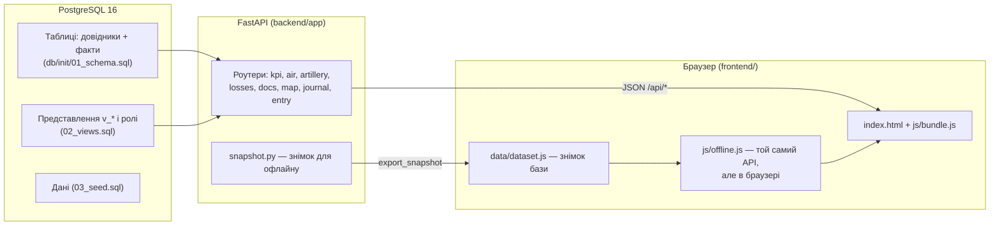

# Інструкція: аналітичний дашборд оперативної обстановки

Цей документ пояснює:
- на чому побудовано дашборд і як він улаштований;
- чим відрізняються онлайн- і офлайн-версія;
- як запустити його на будь-якому комп'ютері;
- як ним користуватися;
- за що відповідає кожна папка і кожен файл проєкту.

> **Навчальний проєкт.**
> - Синтетичні (вигадані) дані: події, втрати, документи, боєприпаси, озброєння, укомплектованість і свої підрозділи. Свої підрозділи позначено «(умовна)».
> - Відкриті дані [DeepStateMap](https://deepstatemap.live), а не офіційні: лінія зіткнення, окупована і «сіра» зони, підрозділи противника.
> - Офіційні логотипи ЗСУ не використовуються.

---

## 1. Що це

Вебдашборд, який зводить в одному місці чотири модулі.

| Модуль | Що показує |
|---|---|
| **A. Повітряна обстановка** | Удари БпЛА, крилатих і балістичних ракет, КАБ: запущено, збито/подавлено, влучання, області. Повітряні тривоги |
| **B. Артилерія** | Обстріли (вогонь противника і своїх засобів), теплокарта за годинами, контрбатарейна боротьба, запас і витрата боєприпасів, стан артилерійського озброєння |
| **C. Особовий склад** | Втрати (лише агрегати, без персональних даних) і укомплектованість підрозділів |
| **D. Документообіг ОКП** | Вхідні документи пункту управління: потік, терміновість, прострочення, черга |

Поверх модулів є:
- **карта** з умовними знаками за наказом № 140;
- **журнал** записів з експортом CSV;
- **друкована довідка**;
- **вкладка «Внесення даних»** (форма та імпорт CSV/Excel).

---

## 2. На чому побудовано

| Частина | Технологія | Навіщо |
|---|---|---|
| База даних | **PostgreSQL 16** | Зберігає довідники й факти; аналітичні представлення `v_*`; ролі доступу |
| Сервер (API) | **Python 3.12+**, **FastAPI**, **psycopg 3** (пул з'єднань), **uvicorn** | Рахує показники SQL-запитами і віддає JSON для графіків, карти, журналу; приймає внесені записи |
| Вебінтерфейс | **HTML + CSS + JavaScript** (ES-модулі без фреймворку) | Сторінки, фільтри, вкладки |
| Графіки | **Chart.js 4.4.4** | Стовпчикові, лінійні, точкові діаграми |
| Карта | **Leaflet 1.9.4** + **OpenStreetMap** / **Natural Earth**, **Leaflet.markercluster** | Підкладка (з інтернетом / без), шари, кластери подій |
| Умовні знаки | **milsymbol 2.x** (MIL-STD-2525C / APP-6) + власний SVG-шар | Знаки за наказом № 140 |
| Excel | **SheetJS CE 0.20.3** | Читання `.xlsx` під час імпорту, шаблони Excel |
| Шрифт | **Volja** (UAF Sans) | Фірмовий шрифт брендбуку |
| Запуск | **Docker Compose** | База й сервер однією командою |
| Збірка | `tools/build.py` (Python, без Node.js) | Збирає JS в один файл, щоб сторінка відкривалася і без сервера |
| Тести | **pytest** + **httpx** | 82 автоматичні тести API |

Усі бібліотеки фронтенду лежать у `frontend/vendor/`. Інтернет потрібен лише для підкладки OpenStreetMap. Без нього карта сама перемикається на векторну «Схему» (Natural Earth: суходіл, кордони, річки, озера, 322 міста). Перемикач «Підкладка» — на панелі карти, вибір запам'ятовується.

---

## 3. Архітектура



**Як проходить запит (онлайн):**
1. Користувач змінює фільтр (період, область, підрозділ).
2. `js/api.js` надсилає `GET /api/...?date_from=…&date_to=…`.
3. Роутер FastAPI будує параметризований SQL. Значення фільтрів підставляються як параметри, а не склеюються в текст запиту — так немає SQL-ін'єкцій.
4. PostgreSQL рахує агрегати.
5. JSON повертається, і браузер малює графік, карту або таблицю.

**Безпека доступу до бази:**
- API читає дані під роллю `dashboard_ro`, яка вміє лише `SELECT`.
- Записи вносить окрема роль `dashboard_rw`, яка вміє лише `INSERT`/`DELETE` у таблиці фактів.
- Синтетичні записи видалити через API не можна.

---

## 4. Онлайн і офлайн: що це і чим відрізняються

Дашборд працює в одному з двох режимів і **визначає режим сам**. Поточний режим показує плашка в шапці.

| | **Онлайн** («Сервер: PostgreSQL») | **Офлайн** («Офлайн: знімок бази») |
|---|---|---|
| Як відкрити | `http://localhost:8000` після запуску сервера | Відкрити `frontend/index.html` подвійним кліком (або з флешки) |
| Що потрібно | Docker (або PostgreSQL + Python) | Лише браузер (Edge, Chrome, Firefox) |
| Звідки дані | Жива база PostgreSQL через FastAPI | Файл `frontend/data/dataset.js` — копія бази на момент створення знімка |
| Актуальність | Завжди поточні дані бази | Дані на момент знімка (дата — у шапці «станом на») |
| Розрахунки | SQL у PostgreSQL | `js/offline.js` повторює ті самі формули в браузері. Звірено автоматично: результати збігаються з сервером |
| Внесення даних | Записуються одразу в базу, їх бачать усі користувачі | Зберігаються лише в цьому браузері (localStorage). Кнопки «Вивантажити .sql / .json» переносять їх у базу |
| Видалення внесених записів | Через API, лише `manual`/`import` | Видаляються з браузера |
| Друкована довідка, CSV, PNG | Так | Так |
| Карта | Так (підкладка OSM потребує інтернету) | Так. Без інтернету — області, зони й знаки на сірому тлі |

**Як дашборд обирає режим.** Під час завантаження `js/api.js`:
- якщо сторінку відкрито як файл (`file://`) — одразу вмикає офлайн-режим;
- інакше перевіряє `GET /api/health`. Якщо сервер не відповів — офлайн, якщо відповів — онлайн.

**Коли який режим потрібен:**
- **Офлайн** — показати дашборд на будь-якому комп'ютері, на захисті, без встановлення програм.
- **Онлайн** — працювати з актуальною базою, вносити дані для всіх, перевіряти SQL-запити і роботу API.

**Як перенести офлайн-записи в базу:**
- вкладка «Внесення даних» → «Вивантажити .sql» → виконати `psql -d dashboard -f entries.sql`;
- або «Вивантажити .json» → у онлайн-режимі на тій самій вкладці «Імпорт» → вибрати файл.

**Як оновити знімок після змін у базі:**
```
python -m backend.export_snapshot
```
Інший спосіб: відкрити `http://localhost:8000/api/snapshot.js`, зберегти й покласти у `frontend/data/dataset.js`.

---

## 5. Як запустити

### 5.1. Найпростіше: офлайн, без встановлення

1. Скопіюйте папку `frontend/` (≈ 10 МБ) на комп'ютер або флешку.
2. Відкрийте `frontend/index.html` у браузері.
3. Готово. У шапці буде плашка «Офлайн: знімок бази».

> Якщо відкривати через розширення VS Code «Live Server» (`http://127.0.0.1:5500/...`), дашборд теж працює в офлайн-режимі: сервера API там немає.

### 5.2. Повний: із сервером через Docker

1. Встановіть і запустіть [Docker Desktop](https://www.docker.com/products/docker-desktop/)
   (або в терміналі: `winget install -e --id Docker.DockerDesktop`).
   Docker на Windows працює через WSL 2. Якщо його ще немає — у PowerShell від адміністратора:
   `wsl --install --no-distribution`, потім **перезавантажте комп'ютер**. У BIOS/UEFI має бути
   ввімкнена віртуалізація (Intel VT-x / AMD-V; у Диспетчері завдань → Продуктивність → ЦП: «Віртуалізація: увімкнено»).
   Після першого запуску Docker Desktop прийміть угоду і дочекайтеся напису «Engine running».
2. Відкрийте термінал у папці `Analytics-Dashboard` (перевірка: `docker --version`).
3. За потреби скопіюйте `.env.example` у `.env` і змініть паролі та порти.
4. Виконайте:
   ```
   docker compose up -d
   ```
   Перший старт триває 1–3 хв: PostgreSQL виконує `db/init/01…03`.
5. Відкрийте **http://localhost:8000**. Документація API: **http://localhost:8000/docs**.

| Що хочу | Що робити (у папці `Analytics-Dashboard`) |
|---|---|
| Відкрити сайт | Запустити Docker Desktop і відкрити `localhost:8000`. Контейнери стартують самі (`restart: unless-stopped`) |
| Зупинити, щоб звільнити пам'ять | `docker compose down` (дані бази лишаються) |
| Запустити знову | `docker compose up -d` |
| Скинути базу до початкових даних (обов'язково після зміни схеми чи `03_seed.sql`) | `docker compose down -v` → `docker compose up -d` |
| Після змін у коді сайту | `docker compose up -d --build` |
| Подивитися, що відбувається / знайти помилку | `docker compose logs -f api` (вихід — Ctrl+C) |
| Чи все запущено | `docker compose ps` |
| Підключитися до БД (DBeaver, pgAdmin) | `localhost:5433`, БД `dashboard`, користувач `dashboard_admin`, пароль з `.env` |

> Якщо раніше вже запускали стару версію, обов'язково виконайте `docker compose down -v`. Інакше в базі не буде нових таблиць і даних: контрбатарейної боротьби, боєприпасів, озброєння, укомплектованості, тилових частин.

#### Що таке Docker і навіщо він

**Docker** — програма, яка запускає інші програми в **контейнерах**. Контейнер — ізольована «коробка», в якій уже є все потрібне програмі: потрібна версія PostgreSQL, Python, бібліотеки й налаштування. У сам Windows при цьому нічого не встановлюється.

Для дашборду «коробки» описано у двох файлах:
- [`docker-compose.yml`](docker-compose.yml) — які контейнери запускати: `db` (PostgreSQL 16 з даними з `db/init/`) і `api` (сервер FastAPI на Python 3.12, який віддає і API, і вебінтерфейс);
- [`backend/Dockerfile`](backend/Dockerfile) — як зібрати контейнер сервера.

Команда `docker compose up -d` читає ці файли і сама завантажує, налаштовує й запускає все потрібне. Дані бази зберігаються в **томі** `pgdata` — окремому сховищі Docker, тому переживають `docker compose down` і зникають лише після `down -v`.

```
Браузер ──► localhost:8000 ──► контейнер api (Python + FastAPI + frontend/)
                                      │
                                      ▼
                               контейнер db (PostgreSQL 16) ──► том pgdata (дані)
```

**Чим відрізняється від звичайного встановлення (розділ 5.3)**

| | Звичайне встановлення | Docker |
|---|---|---|
| Що ставити | PostgreSQL, Python, бібліотеки (`pip install`); вручну створити базу, ролі, завантажити дані | лише Docker Desktop, решту він бере сам |
| Скільки дій | ≈ 10–15 кроків | одна команда `docker compose up -d` |
| Версії | залежать від того, що вже є на комп'ютері (інший Python чи PostgreSQL можуть заважати) | завжди однакові: PostgreSQL 16, Python 3.12 |
| На іншому комп'ютері | усе ставити заново | скопіювати папку й виконати ту саму команду — результат однаковий |
| Прибрати після себе | видаляти PostgreSQL, Python, бази окремо | `docker compose down -v` — не лишається нічого |
| Зіпсувалася база | відновлювати вручну | `down -v` → `up -d`, за хвилину база знову чиста |

**Плюси Docker**
- просто запустити, особливо на чужому комп'ютері (захист практики, перевірка керівником);
- однакове середовище всюди: «у мене працює» означає «працює в усіх»;
- нічого не засмічує в системі й не конфліктує з іншими програмами;
- легко повернути все до початкового стану;
- так розгортають сайти на справжніх серверах — корисна навичка.

**Мінуси Docker**
- важкий: Docker Desktop займає кілька ГБ на диску і ≈ 2 ГБ оперативної пам'яті, поки працює;
- потрібні віртуалізація й WSL 2 (одноразово: увімкнути компонент Windows і перезавантажити ПК);
- Docker Desktop має бути запущений, інакше команди `docker` не працюють;
- перший запуск потребує інтернету (завантажуються образи PostgreSQL і Python), далі вони лишаються на комп'ютері;
- зміни в коді потрапляють у контейнер лише після `docker compose up -d --build`;
- для навчання менш наочно, що відбувається «всередині».

**Який спосіб запуску обрати**

| Спосіб | Коли |
|---|---|
| Docker (5.2) | показати повну версію з базою даних — найпростіше й найнадійніше |
| Звичайне встановлення (5.3) | Docker поставити не можна (немає прав адміністратора, вимкнена віртуалізація) або треба розбиратися з кодом сервера |
| Офлайн-файл (5.1) | швидко показати дашборд без жодного встановлення; дані — знімок бази, внесене зберігається лише в браузері |

### 5.3. Повний без Docker (локальні PostgreSQL і Python)

Потрібні PostgreSQL 16 і Python 3.12+.

```
createdb -p 5433 dashboard
psql -p 5433 -d dashboard -f db/dashboard_dump.sql
python -m venv .venv
.venv\Scripts\activate                 # Linux/macOS: source .venv/bin/activate
pip install -r backend/requirements.txt
copy .env.example .env                 # Linux/macOS: cp .env.example .env
uvicorn backend.app.main:app --port 8000
```
Замість дампу можна виконати по черзі `db/init/01_schema.sql`, `02_views.sql`, `03_seed.sql`.

---

## 6. Як користуватися

### Фільтри (верхня панель)
- **Період:** швидкий вибір або дати «з / по», не більше 366 днів.
- **Область** і **підрозділ:** можна вибрати кілька.
- Фільтри зберігаються в адресі сторінки, тож посиланням можна поділитися з тим самим видом.

### Вкладки
| Вкладка | Що там |
|---|---|
| Огляд | 8 KPI, по одному графіку кожного модуля, карта |
| Повітряна обстановка | A1–A4: динаміка засобів, частка збитих, області, тривоги |
| Артилерія | B1 обстріли; B2 системи; B3 теплокарта годин; B6 контрбатарейна боротьба; B4 запас боєприпасів у добах вогню; B7 стан озброєння; B5 витрата боєприпасів |
| Особовий склад | C1 втрати по тижнях; C2 причини; C3 зв'язок вогню і втрат; C4 укомплектованість по днях; C5 підрозділи з найнижчою укомплектованістю |
| Документообіг ОКП | D1–D4: потік за годинами, нормативи, прострочення, черга |
| Карта | Повна карта з панеллю шарів і таблицею «УМОВНІ ПОЗНАЧЕННЯ» |
| Журнал | Таблиці записів усіх модулів: пошук, сортування, експорт CSV |
| Внесення даних | Форми та імпорт CSV/Excel/JSON |
| Про проєкт | Джерела, обмеження, ліцензії |

Біля кожного графіка є кнопки:
- **«Таблиця»** — дані графіка таблицею за п. 2.3 Порядку;
- **PNG** — зберегти зображення;
- **CSV** — зберегти дані.

**«Довідка (PDF/друк)»** відкриває друковану форму: Times New Roman, «По навчанню», час «ГГ.ХХ ДД.ММ.РРРР».

### Карта
- **Клік по області** вибирає лише її, повторний клік знімає вибір. **Ctrl + клік** додає ще одну область.
- **Шари** вмикаються в панелі праворуч:
  - області;
  - окупована й «сіра» зони;
  - лінія зіткнення;
  - противник;
  - свої підрозділи;
  - місця уражень;
  - артилерійський вогонь;
  - контрбатарейна боротьба;
  - потоки документів;
  - тривоги.
- **Масштаб:** при наближенні знаки збільшуються і з'являються дрібніші ланки (бригади — з 6,5, батальйони — з 8, роти — з 9,5). Близькі події об'єднуються в кружечки з числом. Клік по такому кружечку наближає карту.
- **Монохромний режим** для друку за п. 2.2.13.

### Внесення даних
1. Виберіть тип запису: удар, тривога, артилерія, контрбатарейна боротьба, боєприпаси, озброєння, втрати, укомплектованість, документ ОКП або підрозділ.
2. Заповніть форму. Координати можна поставити кліком на карті, тоді область визначиться автоматично.
3. Для багатьох записів:
   - натисніть «Шаблон CSV» або «Шаблон Excel» і заповніть файл;
   - натисніть «Імпорт» і подивіться попередній перегляд;
   - внесіть записи. Діє правило «все або нічого»: якщо хоч один рядок з помилкою, не вноситься жоден.
4. Внесені записи одразу видно в KPI, графіках, на карті й у журналі. У журналі колонка «Походження запису» показує «внесено вручну» або «імпорт».

---

## 7. Звідки дані

- **Синтетичні дані** генерує `db/generate_seed.py` (зерно 140, період 01.11.2025–31.10.2026). Дані узгоджені між собою:
  - втрати залежать від інтенсивності вогню противника;
  - вогонь у відповідь з'являється і в контрбатарейній боротьбі, і в обстрілах;
  - витрата боєприпасів дорівнює пострілам свого артпідрозділу;
  - укомплектованість зменшується від втрат і зростає від поповнень і повернення поранених.
- **Лінія зіткнення, зони, противник** — з `db/sources/deepstate.json` (DeepStateMap) з датою «станом на».
- **Межі областей** — geoBoundaries (CC BY 4.0).

Як перегенерувати все:
```
python db/generate_seed.py --seed 140 --from 2025-11-01 --to 2026-10-31   # → db/init/03_seed.sql
docker compose down -v && docker compose up -d                          # завантажити в базу
python -m backend.export_snapshot                                         # оновити офлайн-знімок
python tools/build.py                                                     # перезібрати фронтенд
```
Оновити дані DeepStateMap: `python db/sources/update_deepstate.py`.

---

## 8. Структура проєкту: за що відповідає кожна папка й файл

```
Analytics-Dashboard/
├── README.md, ІНСТРУКЦІЯ.md, TZ.md, PROGRESS.md
├── docker-compose.yml, .env.example, .dockerignore, .gitignore
├── db/          — база даних
├── backend/     — сервер FastAPI
├── frontend/    — вебінтерфейс (працює і як окремий HTML)
└── tools/       — збірка фронтенду
```

### Корінь
| Файл | Призначення |
|---|---|
| `README.md` | Короткий опис і швидкий старт |
| `ІНСТРУКЦІЯ.md` | Цей документ |
| `TZ.md` | Технічне завдання: вимоги, модулі, правила оформлення, статус |
| `PROGRESS.md` | Що зроблено, ухвалені рішення, що лишилося |
| `docker-compose.yml` | Два сервіси: `db` (PostgreSQL 16, порт 5433) і `api` (FastAPI, порт 8000) |
| `.env.example` | Зразок налаштувань: паролі, порти. Скопіювати в `.env` |
| `.dockerignore` | Що не потрапляє в образ Docker |
| `.gitignore` | Що не потрапляє в git: `.env`, кеші, venv |

### `db/` — база даних
| Файл | Призначення |
|---|---|
| `init/01_schema.sql` | Схема. Довідники: `oblasts`, `units`, `enemy_units`, `weapon_types`, `target_categories`, `info_sources`, `doc_sla_norms`, `contact_line`, `dataset_meta`. Факти: `attack_waves`, `strike_events`, `air_alerts`, `artillery_fire`, `counter_battery`, `ammo_supply`, `artillery_equipment`, `personnel_losses`, `unit_strength`, `incoming_documents`. Обмеження й індекси |
| `init/02_views.sql` | Аналітичні представлення `v_*`, `v_as_of` (момент «станом на»), ролі `dashboard_ro` / `dashboard_rw` і права |
| `init/03_seed.sql` | Згенеровані дані (команди `COPY`) |
| `dashboard_dump.sql` | Повний дамп (схема + дані + ролі) одним файлом для `psql -f` |
| `generate_seed.py` | Генератор синтетичних даних → `03_seed.sql` |
| `oblasts_ref.py` | Довідник областей: ISO-код, назви, ознаки «прифронтова» / «окупована» |
| `sources/ukraine-oblasts.geojson` | Межі областей (geoBoundaries) |
| `sources/deepstate.json` | Лінія зіткнення, зони, підрозділи противника (DeepStateMap) |
| `sources/update_deepstate.py` | Завантажує свіжі дані DeepStateMap |
| `sources/basemap.json` | Підкладка карти без інтернету (Natural Earth: суходіл, озера, кордони, річки, міста), обрізана до регіону |
| `sources/update_basemap.py` | Завантажує й готує `basemap.json` з Natural Earth (запускати лише для оновлення) |

### `backend/` — сервер
| Файл | Призначення |
|---|---|
| `Dockerfile` | Образ сервера: Python 3.12, залежності, код, фронтенд |
| `requirements.txt` | Залежності Python із зафіксованими версіями |
| `export_snapshot.py` | CLI: створює офлайн-знімок `frontend/data/dataset.js` |
| `app/main.py` | Точка входу FastAPI: підключає роутери, пули з'єднань, CORS, роздає `frontend/` |
| `app/config.py` | Налаштування з `.env`: хост, порт, ролі, ліміти |
| `app/db.py` | Пули з'єднань psycopg: читання (`dashboard_ro`) і запис (`dashboard_rw`) |
| `app/filters.py` | Фільтри запитів (період, області, підрозділи) і безпечне складання `WHERE` |
| `app/schemas.py` | Моделі Pydantic: фільтри, KPI |
| `app/labels.py` | Українські назви кодових значень (результат, причина, вид боєприпасу…) |
| `app/sidc.py` | Коди умовних знаків (2525C), класи калібру за табл. 16 Порядку |
| `app/geo.py` | Визначення області за координатами |
| `app/snapshot.py` | Формує знімок бази для офлайну |
| `app/routers/meta.py` | `/api/health`, `/api/meta`, довідники |
| `app/routers/kpi.py` | Показники KPI зі зміною до попереднього періоду |
| `app/routers/air.py` | Модуль A: удари, частка збитих, області, місця уражень, тривоги |
| `app/routers/artillery.py` | Модуль B: обстріли, системи, теплокарта, контрбатарейна боротьба, боєприпаси, озброєння |
| `app/routers/losses.py` | Модуль C: втрати, причини, кореляція, укомплектованість |
| `app/routers/docs.py` | Модуль D: потік документів, нормативи, прострочення, черга |
| `app/routers/map.py` | Карта: підрозділи, противник, лінія, зони, потоки ОКП, хороплет |
| `app/routers/journal.py` | Журнал записів усіх модулів і експорт CSV |
| `app/routers/entry.py` | Внесення даних: форма, імпорт CSV/JSON, перевірка, видалення |
| `app/routers/common.py` | Спільні шматки SQL і GeoJSON |
| `tests/test_api.py` | 82 тести API: ендпоінти, фільтри, захист від SQL-ін'єкцій, внесення, узгодженість даних |

### `frontend/` — вебінтерфейс
| Файл / папка | Призначення |
|---|---|
| `index.html` | Головна сторінка: шапка, фільтри, вкладки |
| `print.html` | Друкована довідка |
| `css/tokens.css` | Кольори брендбуку (світла й темна теми) |
| `css/style.css` | Верстка, картки, таблиці, стилі карти |
| `css/fonts.css` | Шрифт Volja, вбудований у CSS (генерується збіркою) |
| `fonts/` | Файли шрифту Volja (джерело для збірки) |
| `data/dataset.js` | Офлайн-знімок бази (генерується `export_snapshot`) |
| `data/geo.js` | Межі областей, лінія, зони для карти (генерується збіркою; геометрію спрощено алгоритмом Дугласа — Пекера, межі областей ±300 м, зони ±80 м) |
| `data/basemap.js` | Підкладка «Схема» без інтернету (генерується збіркою з `db/sources/basemap.json`) |
| `js/app.js` | Точка входу: вкладки, фільтри, перемальовування |
| `js/state.js` | Стан фільтрів і синхронізація з адресою сторінки |
| `js/api.js` | Вибір режиму (онлайн/офлайн), запити, завантаження CSV |
| `js/offline.js` | Офлайн-рушій: повторює всі ендпоінти API в браузері |
| `js/entries-store.js` | Офлайн-записи в браузері, перевірки, вивантаження `.sql` / `.json` |
| `js/entry.js` | Вкладка «Внесення даних» |
| `js/journal.js` | Вкладка «Журнал» |
| `js/kpi.js` | Картки KPI |
| `js/map.js` | Карта: шари, масштаб, лінія зіткнення, потоки, легенда |
| `js/symbols.js` | Умовні знаки: milsymbol + позначки ураження, «?», боєздатність, знак цілі |
| `js/format.js` | Формати чисел і часу (`uk-UA`, «ГГ.ХХ ДД.ММ.РРРР») |
| `js/fonts.js` | Підвантаження шрифтів для графіків |
| `js/print.js` | Логіка друкованої довідки |
| `js/charts/common.js` | Картка графіка, таблиці, експорт PNG/CSV, палітра |
| `js/charts/air.js` | Графіки A1–A4 |
| `js/charts/artillery.js` | Графіки B1–B7 |
| `js/charts/losses.js` | Графіки C1–C5 |
| `js/charts/docs.js` | Графіки D1–D4 |
| `js/bundle.js`, `js/print.bundle.js` | **Зібрані** файли, які підключає сторінка. Не редагувати вручну: генерує `tools/build.py` |
| `vendor/` | Сторонні бібліотеки: Leaflet, markercluster, Chart.js, milsymbol, SheetJS |

### `tools/`
| Файл | Призначення |
|---|---|
| `build.py` | Збирає ES-модулі `js/*.js` у `bundle.js` (сторінка працює з `file://`), створює `data/geo.js` (зі спрощенням геометрії) і `data/basemap.js`, вбудовує шрифти в `css/fonts.css` |

> **Після зміни будь-якого файлу в `frontend/js/`** обов'язково виконайте `python tools/build.py`. Сторінка підключає зібраний `bundle.js`, а не вихідні модулі.

---

## 9. Перевірка

| Що | Команда |
|---|---|
| Тести API (потрібна жива БД) | `pytest backend/tests -q` |
| Перезібрати фронтенд | `python tools/build.py` |
| Оновити офлайн-знімок | `python -m backend.export_snapshot` |

---

## 10. Типові проблеми

| Проблема | Причина і рішення |
|---|---|
| Плашка «Офлайн», хоча сервер запущено | Сторінку відкрито як файл або через Live Server. Відкрийте `http://localhost:8000` |
| Після оновлення коду нічого не змінилося | Не перезібрано бандл (`python tools/build.py`) або браузер узяв стару версію з кешу (Ctrl+F5) |
| В онлайн-режимі немає нових графіків B4–B7, C4–C5 | База створена старою схемою: `docker compose down -v && docker compose up -d` |
| Карта без вулиць, лише схема | Немає інтернету для OpenStreetMap — автоматично показано «Схему» (Natural Earth). Решта шарів працює. Повернути OSM: «Підкладка» на панелі карти |
| `docker` не знайдено / «WSL 2 is unable to start» / «Virtual Machine Platform is not enabled» | Docker Desktop не встановлено або не перезавантажено ПК після `wsl --install`; перевірте віртуалізацію в BIOS (див. 5.2) |
| `failed to connect to the docker API … dockerDesktopLinuxEngine` | Docker Desktop не запущено. Запустіть його й дочекайтеся «Engine running» |
| `lookup registry-1.docker.io: no such host` | Немає інтернету (часто одразу після перезавантаження ПК). Зачекайте хвилину й повторіть `docker compose up -d` |
| `Conflict. The container name … is already in use` | `docker compose up` запустили двічі одночасно. Виконайте `docker compose down`, потім `docker compose up -d` |
| Браузер: «Немає звʼязку із сайтом», `DNS_PROBE_FINISHED_NXDOMAIN` | Помилка в адресі (напр. `http//` без двокрапки). Введіть просто `localhost:8000` |
| На карті замість фону «Access blocked» | OpenStreetMap не отримав адресу сайту. Відкривайте через `http://localhost:8000` (не як файл) і оновіть сторінку Ctrl+F5 |
| На карті кружечки з числами замість знаків | Це об'єднані близькі події (кластери). Наблизьте карту або клікніть по кружечку |
| Помилка «Період не може перевищувати 366 днів» | Зменште період у фільтрі |
| Записи, внесені офлайн, не видно на іншому комп'ютері | Вони зберігаються лише в цьому браузері. Вивантажте `.sql` / `.json` і внесіть у базу |

---

## 11. Стандарти, яких дотримано

- **Наказ № 140 (ВКДП 5(3)-00(01).02):**
  - час «ГГ.ХХ ДД.ММ.РРРР», київський (п. 2.1.1);
  - кольори: свої — синім, противник — червоним (п. 2.2.2–2.2.4, табл. 6);
  - позначки ураження (п. 2.2.12);
  - монохромний варіант (п. 2.2.13);
  - скорочення джерел і «?» (п. 2.2.15);
  - власні знаки в таблиці «УМОВНІ ПОЗНАЧЕННЯ» (п. 2.2.16);
  - таблиці: «№ з/п», без порожніх клітинок, «немає відом.» (п. 2.3);
  - рамки знаків (табл. 4), ланки (табл. 8), класи калібру (табл. 16);
  - пункти управління (п. 6.1), лінія зіткнення (п. 6.2.1), вогонь по одиночній цілі (п. 6.2.2), «Вибух, підрив» (п. 6.12).
- **Правило вибору знака:** спершу наказ № 140, якщо там немає — APP-6 / MIL-STD-2525C.
- **Брендбук:** шрифт Volja, палітра, без офіційних логотипів.
- **Графіки:**
  - одна вісь Y;
  - вісь стовпчиків від нуля;
  - підписи одиниць;
  - джерело і «станом на» під кожним графіком;
  - таблиця даних і експорт.

## 12. Джерела та ліцензії

- © OpenStreetMap contributors (ODbL);
- Natural Earth (суспільне надбання) — підкладка без інтернету;
- geoBoundaries (CC BY 4.0);
- DeepStateMap (відкриті дані, не офіційні);
- Leaflet і markercluster (BSD-2);
- milsymbol (MIT);
- Chart.js (MIT);
- SheetJS CE (Apache-2.0);
- шрифт Volja — надано замовником.
