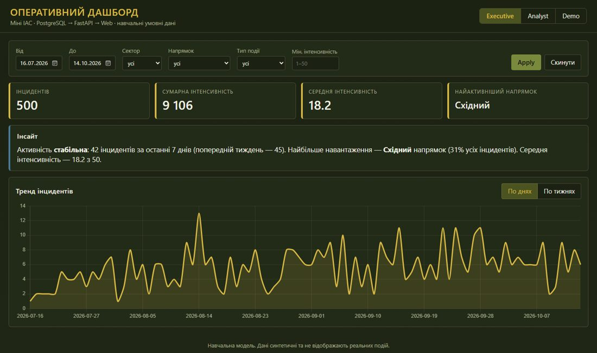
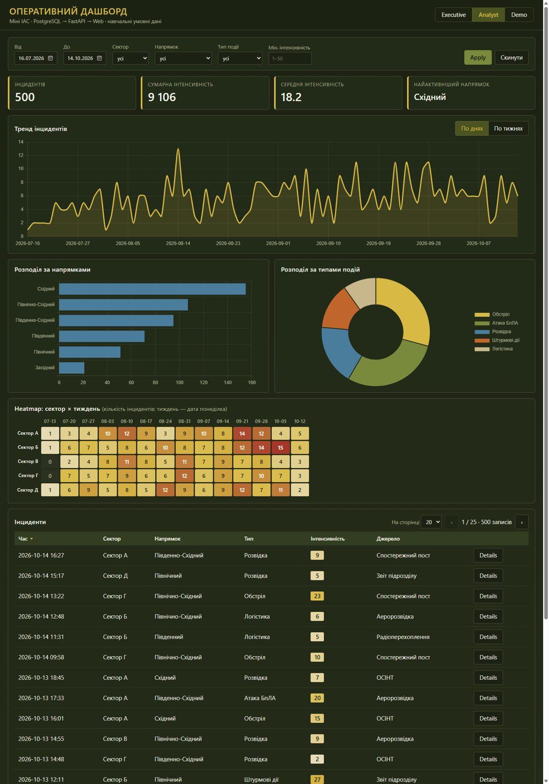
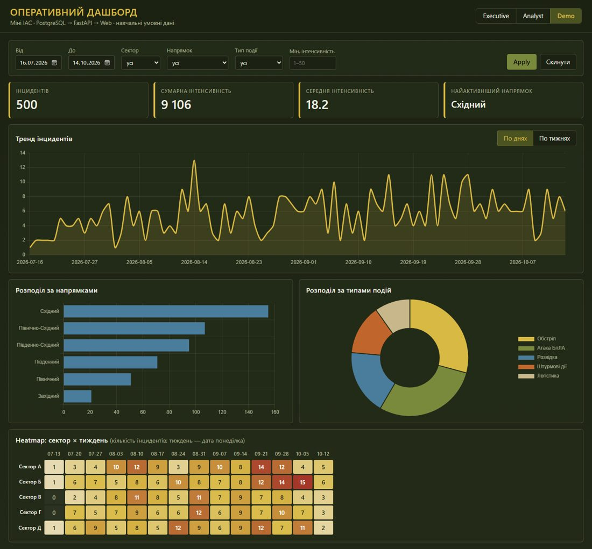

# Практична робота 5.8 — Міні ІАС «Оперативний Дашборд»

**Тема 5. Заняття 8.** Розробка та демонстрація візуалізацій для різних аудиторій в межах виконання індивідуальних (групових) проектів.
**Варіант 4 — «Оперативний Дашборд»:** універсальна панель ситуаційних показників — KPI, тренд по днях/тижнях, 2 розподіли (за напрямками та типами), heatmap «сектор × тиждень», таблиця інцидентів з пагінацією і модальними деталями, централізована фільтрація.

Архітектура: **PostgreSQL → FastAPI (sync, psycopg2, raw SQL) → Web (HTML/CSS/JS + Chart.js з CDN)**. Без Docker, async і ORM.

| Executive | Analyst | Demo |
|---|---|---|
|  |  |  |

## Структура

```text
Practik5_8/
├── db/
│   ├── schema.sql        # таблиця incidents + 4 індекси
│   └── seed.py           # 500 синтетичних записів за 90 днів
├── api/
│   ├── db.py             # get_conn(): psycopg2, autocommit, без пулів/ORM
│   └── main.py           # FastAPI-ендпоїнти, raw SQL
├── web/
│   ├── index.html
│   ├── app.js            # API_BASE_URL = "http://localhost:8000"
│   └── styles.css
├── scripts/              # init_db, seed_db, smoke_test (.sh та .ps1)
├── docs/                 # скріншоти режимів
├── .env.example
├── requirements.txt
└── README.md
```

## Запуск за 3 хвилини

Потрібні: Python 3.10+ та локальний PostgreSQL (`psql` у PATH).

### Windows (PowerShell)
```powershell
python -m venv .venv
.\.venv\Scripts\Activate.ps1
pip install -r requirements.txt
copy .env.example .env            # вписати USER і PASSWORD у DATABASE_URL
psql -U postgres -c "CREATE DATABASE operatyvnyi_dashbord;"
.\scripts\init_db.ps1
.\scripts\seed_db.ps1
uvicorn api.main:app --reload     # API: http://localhost:8000  (документація: /docs)
# у другому терміналі:
cd web; python -m http.server 5500
# у третьому терміналі (за бажанням):
.\scripts\smoke_test.ps1
```

### Linux / macOS
```bash
python3 -m venv .venv
source .venv/bin/activate
pip install -r requirements.txt
cp .env.example .env              # вписати USER і PASSWORD у DATABASE_URL
psql -U postgres -c "CREATE DATABASE operatyvnyi_dashbord;"
bash scripts/init_db.sh
bash scripts/seed_db.sh
uvicorn api.main:app --reload
# у другому терміналі:
cd web && python -m http.server 5500
# у третьому терміналі (за бажанням):
bash scripts/smoke_test.sh
```

Відкрити: <http://localhost:5500/?view=analyst> (також `?view=executive`, `?view=demo`).

## API

Усі аналітичні ендпоїнти приймають однакові необов'язкові фільтри: `from`, `to` (YYYY-MM-DD, включно), `sector`, `direction`, `event_type`, `min_intensity` (1..50).

| Ендпоїнт | Відповідь |
|---|---|
| `GET /health` | `{ "status": "ok" }` |
| `GET /filters` | `{ sectors, directions, event_types, min_date, max_date }` |
| `GET /kpi` | `{ total_incidents, total_intensity, avg_intensity, top_direction }` |
| `GET /trend?group=day\|week` | `[{ t, value }]`, value = COUNT |
| `GET /distribution/directions` | `[{ label, value }]` |
| `GET /distribution/types` | `[{ label, value }]` |
| `GET /heatmap` | `{ columns: [тижні], rows: [{ sector, values }] }` (кількість; тиждень = дата понеділка) |
| `GET /incidents?page=1&page_size=20&sort=occurred_at&order=desc` | `{ total, page, page_size, items }` |
| `GET /incidents/{id}` | повний запис |

**Валідація:**
- `page_size` — від 5 до 100;
- `sort` — лише колонки з білого списку, тому SQL-ін'єкція через назву колонки неможлива;
- некоректна дата або `from` > `to` → 400;
- неіснуючий `id` → 404.

Значення фільтрів передаються в SQL тільки як параметри (`%s`). CORS дозволено для всіх джерел, як вимагає інструкція.

## Режими для різних аудиторій (`?view=`)

| Режим | Аудиторія | Що показано | Що приховано |
|---|---|---|---|
| `executive` | керівник | KPI, тренд, автоматичний текст-інсайт (динаміка за 7 днів, головний напрямок і його частка) | розподіли, heatmap, таблиця |
| `analyst` | аналітик | усе: фільтри, KPI, тренд, 2 розподіли, heatmap, таблиця з сортуванням, пагінацією і модальними деталями | — |
| `demo` | відкритий показ | KPI, графіки, heatmap | таблиця інцидентів; поле `source` прибране всюди (і в таблиці, і в модальному вікні) |

Після натискання **Apply** всі видимі блоки перезавантажуються з однаковими фільтрами.

## Сценарій демонстрації (≈5 хв)

1. `?view=executive` — «Ось загальна картина»: 4 KPI, тренд за 90 днів і готовий висновок одним абзацом.
2. Фільтр **Напрямок = Східний**, мінімальна інтенсивність 30 → Apply. KPI, тренд та інсайт оновлюються узгоджено.
3. Перемкнути тренд **По тижнях**: видно зростання активності протягом періоду.
4. `?view=analyst` — розподіли показують, що Східний напрямок і обстріли/БпЛА дають основну частку подій.
5. Heatmap «сектор × тиждень» показує, у яких секторах і тижнях були піки.
6. Таблиця: сортування за інтенсивністю → **Details** → модальне вікно з повним описом інциденту.
7. `?view=demo` — та сама аналітика для відкритого показу: без таблиці й без поля «Джерело».

## Перевірка

Перевірено локально на PostgreSQL 16.2 (Windows):
- `init_db` і `seed_db` створюють 500 записів: 5 секторів, 6 напрямків, 5 типів, інтенсивність 1..50, період 90 днів;
- `smoke_test` повертає `OK` для `/health`, `/filters`, `/kpi`, `/trend`;
- усі три режими перевірено в браузері (скріншоти в `docs/`).

> Дані синтетичні та навчальні; реальних подій не відображають. Файл `.env` з паролем до БД внесено в `.gitignore`.
